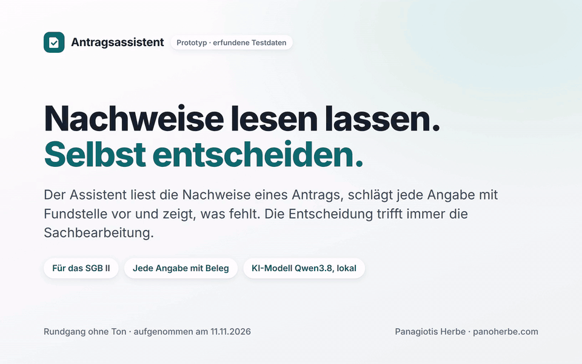
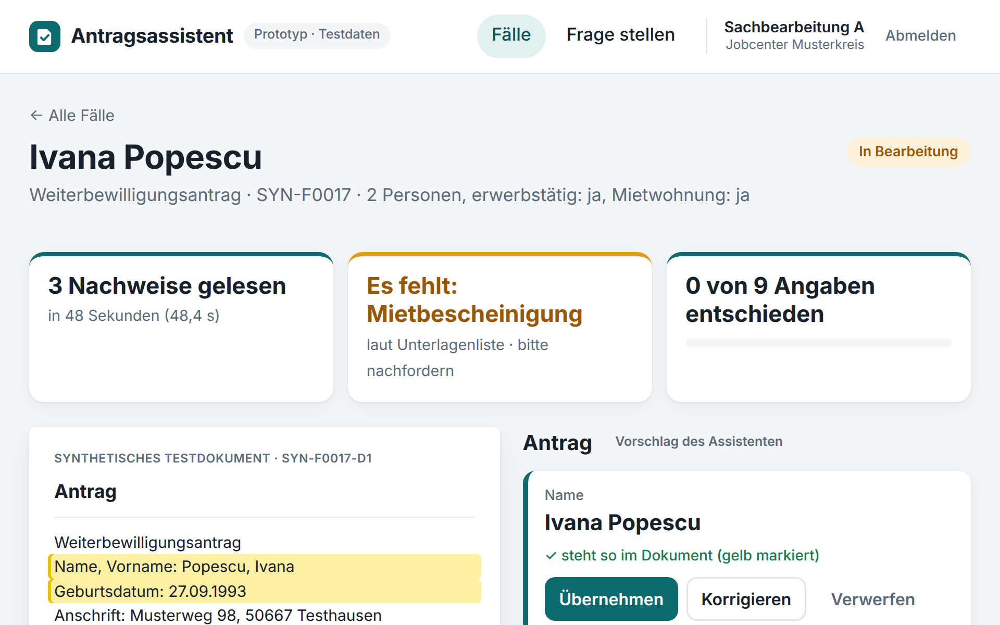
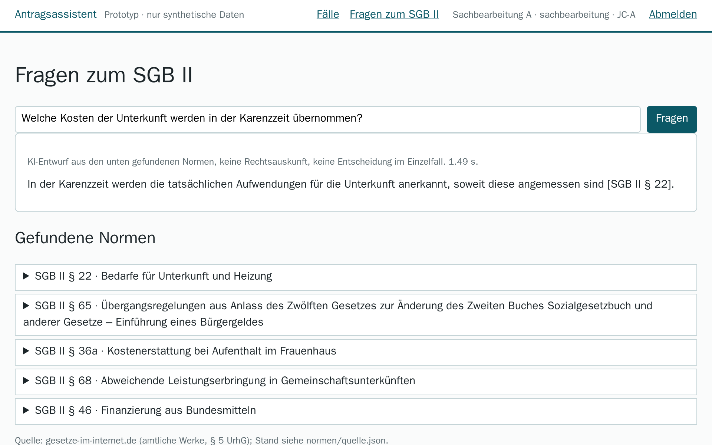
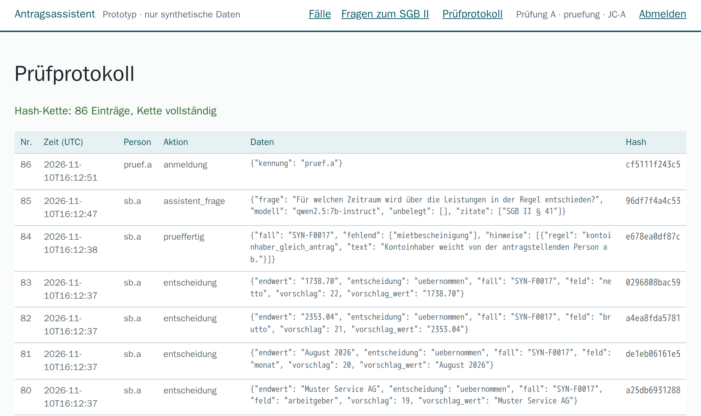

# Antragsassistent

**KI-Unterstützung für die Antragsbearbeitung im SGB II: liest die Nachweise eines Antrags, schlägt jede Angabe mit
Fundstelle vor, findet fehlende Unterlagen und beantwortet Fragen zum SGB II mit Paragrafenangabe. Entscheiden tut
immer ein Mensch. Das läuft heute, lokal, mit synthetischen Testdaten.**



<sub>Rundgang, 63 Sekunden, ohne Ton, mit Untertiteln; aufgenommen am 03.11.2026 an einer laufenden Installation mit
einem offenen Sprachmodell auf einer GPU. Wartezeiten des Modells sind im Video gekürzt; die Anwendung zeigt die echte
Dauer an. [Video herunterladen (MP4, 1,3 MB)](https://github.com/panoherbe/antragsassistent/raw/main/medien/rundgang.mp4)
· Text des Rundgangs weiter unten.</sub>

## Was Sie brauchen → läuft hier schon

| Was Sie brauchen | läuft hier schon (gemessen am 02.11.2026, 40 synthetische Fälle, 133 Dokumente, 418 Angaben) |
|---|---|
| Dokumente eines Antrags automatisch auswerten | Dokumentart in 133 von 133 Dokumenten richtig; 95,9 % der Angaben richtig; 4,2 s je Dokument im Median (95 %: 6,3 s) mit einem offenen Modell auf einer GPU mit 12 GB |
| Nachvollziehbare Vorschläge statt Blackbox | jede Angabe mit Fundstelle; „belegt“ nur, wenn die zitierte Zeile wörtlich im Dokument steht und den Wert enthält: 96,4 % belegt, davon 99,3 % richtig; Unbelegtes lässt sich nicht übernehmen, nur selbst eintragen |
| Fehlende Nachweise erkennen | in allen 40 Fällen richtig (7 mit Lücke), nach einer lesbaren Regelliste ohne KI, änderbar ohne Programmierung |
| Die Entscheidung bleibt beim Menschen | je Angabe übernehmen, korrigieren oder verwerfen, keine Sammelübernahme; „prüffertig“ erst, wenn nichts mehr offen ist; Export danach |
| Fragen zum SGB II beantworten | Suche in SGB II und SGB I §§ 60–67: erwarteter Paragraf bei 91,1 % von 45 Testfragen unter den ersten drei; in 15 von 15 Antworten stehen alle genannten Fundstellen unter den Treffern |
| Revisionssicher protokollieren | Prüfprotokoll nur erweiterbar, mit Hash-Kette; je Vorschlag Modell, Prompt- und Regelversion |
| Rollen und Mandanten trennen | Sachbearbeitung entscheidet, Prüfung liest, Administration prüft nur die Kette; Fälle anderer Jobcenter gesperrt |
| Daten bleiben im Haus | Modell und Anwendung laufen auf demselben Rechner, kein Cloud-Dienst; Modell austauschbar |
| Geprüfte Qualität | 24 automatische Tests grün (03.11.2026; das Messprotokoll vom 02.11.2026 nennt 23, dazu kam der Test zur Korrektur der Fragen-Seite); alle drei Messläufe offen, auch der schlechtere |
| Offen und übergabefähig | Quellcode unter AGPL-3.0, Modelle unter Apache 2.0 und MIT |

Messweg, alle drei Messläufe und die verbleibenden Fehler: [Messprotokoll](nachweis/PROTOKOLL.md).

## In zwei Minuten selbst prüfen

1. **Das Messprotokoll lesen:** [nachweis/PROTOKOLL.md](nachweis/PROTOKOLL.md) – Ergebnisse, der schlechtere zweite
   Lauf und was in der gültigen Fassung noch falsch ist.
2. **Die Tests laufen lassen** (Docker, ohne Sprachmodell, gemessen 6 s):
   ```bash
   git clone https://github.com/panoherbe/antragsassistent.git
   cd antragsassistent
   docker compose run --rm test
   ```
3. **Die ganze Anwendung starten** (Docker mit Compose, NVIDIA-GPU mit 8 GB oder mehr): Abschnitt „Start“ unten; die
   beiden Modelle sind zusammen 5,8 GB groß.

## Ihr Vorteil: Sie bewerten ein laufendes System, kein Versprechen

- **Sie sehen vorher, wie die KI-Unterstützung arbeitet:** mit Fundstelle, mit menschlicher Entscheidung und mit
  Protokoll, nicht als Folie.
- **Die Qualität ist gemessen, nicht behauptet:** an 133 Dokumenten, mit allen drei Messläufen und den verbleibenden
  Fehlern offen. Derselbe Messweg prüft im Projekt jedes Modell und jede Änderung.
- **Die heiklen Teile sind von Anfang an da:** menschliche Letztentscheidung, Nachvollziehbarkeit, Rollen,
  Mandantentrennung und ein manipulationssicheres Protokoll.
- **Keine Bindung an einen Anbieter:** offener Quellcode (AGPL-3.0), offene Modelle, Modell austauschbar.

## So sieht es aus

<table>
<tr>
<td width="50%" valign="top"><br><sub>Nach der Auswertung: oben die echte Dauer und der fehlende Nachweis (gefunden von der Regelliste); links das Dokument, rechts jede Angabe mit Fundstelle und „Fundstelle geprüft“. Entschieden wird je Angabe.</sub></td>
<td width="50%" valign="top"><br><sub>Fragen zum SGB II: Antwort nur aus den gefundenen Paragrafen, jede genannte Fundstelle gegen die Treffer geprüft. Ein Entwurf, keine Rechtsauskunft.</sub></td>
</tr>
<tr>
<td colspan="2" valign="top"><br><sub>Das Prüfprotokoll, wie die Rolle „Prüfung“ es sieht: wer wann was entschieden hat, mit Modell und Regelversion; die Hash-Kette zeigt jede nachträgliche Änderung.</sub></td>
</tr>
</table>

<details>
<summary><b>Text des Rundgangs</b> (die Untertitel des Videos)</summary>

| ab | Untertitel |
|---|---|
| 0:00 | **Titel:** Antragsassistent – KI-assistierte Antragsbearbeitung im SGB II: Dokumente auswerten, Angaben mit Fundstelle vorschlagen, fehlende Nachweise finden. Entscheiden tut immer ein Mensch. |
| 0:04 | Anmeldung als Sachbearbeitung, mit einer Demo-Kennung. Alle Daten sind erfunden. |
| 0:08 | Die Fälle des eigenen Jobcenters. Fälle anderer Jobcenter sind gesperrt. |
| 0:11 | Ein Antrag mit seinen Nachweisen, so wie sie eingehen: noch nicht ausgewertet. |
| 0:14 | Ein offenes Sprachmodell liest die Dokumente – auf diesem Rechner, ohne Cloud-Dienst … (Die Wartezeit ist im Video gekürzt; die echte Dauer meldet die Anwendung gleich selbst.) |
| 0:16 | … fertig: „3 Dokumente in 13.46 s ausgewertet“. (Gemessen an 133 Dokumenten, 02.11.2026: 4,2 s je Dokument im Median.) |
| 0:20 | Fehlende Nachweise findet eine feste, lesbare Regelliste – ohne KI. |
| 0:23 | Jede Angabe kommt mit Fundstelle: Die zitierte Zeile steht wörtlich im Dokument. Nur belegte Angaben lassen sich übernehmen. |
| 0:27 | Die Sachbearbeitung entscheidet jede Angabe einzeln: übernehmen, korrigieren oder verwerfen. |
| 0:31 | Die übrigen 8 Angaben ebenso (im Video übersprungen). Erst wenn keine Angabe mehr offen ist, lässt sich der Fall als prüffertig markieren. |
| 0:34 | Prüffertig – mit Export als JSON für die weitere Bearbeitung im Fachverfahren. |
| 0:37 | Fragen zum SGB II: Die Antwort stützt sich nur auf gefundene Paragrafen. |
| 0:40 | Jede genannte Fundstelle wird gegen die Treffer geprüft. Ein Entwurf, keine Rechtsauskunft. |
| 0:47 | Anmeldung als Prüfung: sieht Fälle und Protokoll, entscheidet aber nichts. |
| 0:49 | Das Prüfprotokoll: wer wann was entschieden hat, mit Modell und Regelversion. Die Hash-Kette macht jede nachträgliche Änderung sichtbar. |
| 0:53 | **Gemessen am 02.11.2026, 40 synthetische Fälle:** 95,9 % der 418 Angaben richtig, Dokumentart in 133 von 133 Dokumenten richtig · 99,3 % der belegten Angaben richtig (belegt heißt: die Fundstelle steht wörtlich im Dokument) · fehlende Nachweise in allen Fällen richtig erkannt (7 Fälle mit Lücke) · 4,2 s je Dokument (Median) mit einem offenen Modell auf einer GPU mit 12 GB. |
| 0:59 | **Selbst prüfen:** Quellcode, 24 Tests, Goldsatz und Messprotokoll liegen offen. Die Tests laufen ohne Sprachmodell mit einem Befehl. AGPL-3.0. |

</details>

## Ehrlich gesagt: Was der Prototyp noch nicht ist

Ein Prototyp mit synthetischen Testdaten, kein Produkt. Er verarbeitet keine echten Personen- oder Sozialdaten und nimmt
nur Dokumente an, die als synthetisches Testdokument gekennzeichnet sind.

| Heute noch nicht enthalten | Was ein Auftrag ergänzen würde |
|---|---|
| Echte Nachweise: die synthetischen Dokumente sind Text aus Vorlagen; Scans, Tabellen in PDF und Handschrift sind schwerer, eine Texterkennung fehlt | Texterkennung und Messung an realistischen, freigegebenen Testdokumenten |
| Eine fachlich abgestimmte Unterlagenliste; die mitgelieferte ist ein Beispiel | Ihre Regeln, mit Ihrer Fachseite festgelegt |
| Ein unabhängiger Maßstab für die Suche; der Goldsatz ist selbst geschrieben | Testfragen aus Ihrer Praxis |
| Anmeldung über OpenID Connect oder SAML, Anbindung an Fachverfahren oder DMS | Anbindung an Ihre Umgebung |
| Betrieb mit echten Daten, Einordnung nach der EU-KI-Verordnung | Betrieb in einem EU-Rechenzentrum, Einordnung und Dokumentation |
| Bescheide, Leistungsberechnung, Zahlungen | bewusst nicht Teil des Assistenten |

Antworten des Assistenten sind Entwürfe, keine Rechtsauskunft.

## Lizenz

Ab 04.11.2026 AGPL-3.0. Frühere Stände bis Commit [`4650be4`](https://github.com/panoherbe/antragsassistent/tree/4650be4) bleiben unter Apache-2.0. Auftraggeber erhalten im Auftrag die vertraglich vereinbarte Lizenz.

## Kontakt

Panagiotis Herbe · [panoherbe.com](https://panoherbe.com)

---

## Für Ihre IT: Technik im Detail

### Bausteine

| Baustein | Umsetzung |
|---|---|
| Eingang | Dokumente nur mit Kennung `SYN-…` (sonst abgewiesen und protokolliert), SHA-256 je Dokument |
| Dokumentart und Angaben | offenes Sprachmodell (lokal über Ollama) liest Dokumentart und Felder in ein festes JSON-Schema (strukturierte Ausgabe) |
| Fundstellenprüfung | eine Angabe gilt nur als **belegt**, wenn die zitierte Zeile wörtlich im Dokument steht und den Wert enthält; unbelegte Angaben können nicht übernommen, nur von Hand eingetragen werden |
| Unterlagenliste und Plausibilität | feste Regeln ohne KI in `konfiguration/unterlagen.yaml` (Beispielkonfiguration), lesbar und änderbar ohne Programmierung; Ausdrücke werden nicht frei ausgewertet |
| Menschliche Letztentscheidung | Entscheidung je Angabe, keine Sammelübernahme; Status „prüffertig“ erst, wenn nichts mehr offen ist; Export nur danach |
| Fragen zum SGB II | Suche in SGB II und SGB I §§ 60–67 (bge-m3; BM25 und die Kombination sind gemessen und schwächer), Antwort nur aus den gefundenen Normen, jede genannte Fundstelle wird gegen die Treffer geprüft |
| Rollen | Sachbearbeitung (entscheidet), Prüfung (liest Fälle und Protokoll, entscheidet nicht), Administration (prüft nur die Protokollkette, sieht keine Fallinhalte) |
| Mandanten | jede fachliche Tabelle trägt die Jobcenter-Kennung; fremde Fälle sind gesperrt |
| Prüfprotokoll | nur erweiterbar (Datenbank-Trigger), Hash-Kette über alle Einträge; jede Änderung fällt bei der Prüfung auf; Modell, Prompt-Version und Regelversion je Vorschlag |
| Schnittstelle | REST mit OpenAPI (`/docs`, `/openapi.json`), Export als JSON |

**Bewusst nicht umgesetzt:** Berechnung des Leistungsanspruchs, Bescheide, Zahlungen, Anbindung an Fachverfahren
oder DMS, Texterkennung gescannter Papierdokumente (die synthetischen Dokumente sind Text), Anmeldung über
OpenID Connect/SAML, Betrieb mit echten Daten.

### Wo was läuft

| Teil | Ort |
|---|---|
| Sprachmodell `qwen2.5:7b-instruct` (Apache 2.0) und Einbettungsmodell `bge-m3` (MIT) | eigener Ollama-Container auf demselben Rechner, GPU; kein Aufruf eines Cloud-Dienstes |
| Anwendung (FastAPI, SQLite) | Container, lauscht nur auf `127.0.0.1` |
| Gesetzestexte | einmalig von gesetze-im-internet.de geladen (`normen/laden.py`), Prüfsumme in `normen/quelle.json` |

Das Modell ist über `OLLAMA_URL`, `SPRACHMODELL` und `EINBETTUNGSMODELL` austauschbar, etwa gegen einen
Modelldienst mit Verarbeitung in der EU. Kein anderer Teil des Codes spricht mit einem Modell (`app/llm.py`).

### Start

Voraussetzung: Docker mit Compose, für flüssige Antworten eine NVIDIA-GPU mit 8 GB oder mehr (gemessen: RTX 3060,
12 GB).

```bash
echo "DEMO_PASSWORT=$(openssl rand -hex 8)" > .env      # Passwort der Demo-Kennungen
docker compose up -d
docker compose exec ollama ollama pull qwen2.5:7b-instruct
docker compose exec ollama ollama pull bge-m3
# Oberfläche: http://127.0.0.1:8420  (Kennungen sb.a, sb.b, pruef.a, admin; Passwort aus .env)
```

Beim Start legt die Anwendung 20 synthetische Fälle für zwei fiktive Jobcenter an (`DEMO_FAELLE`).

```bash
docker compose run --rm test                                          # 24 Tests, ohne Modell
docker compose run --rm app python -m normen.laden                    # Gesetzestexte neu laden
docker compose run --rm app python -m eval.messen --ausgabe nachweis/neu   # Messlauf
```

### Aufbau

```
app/synth.py        Generator synthetischer Fälle (Antrag, Entgeltabrechnung, Mietbescheinigung, Kontoauszug)
app/extraktion.py   Dokumentart, Felder, Fundstellenprüfung
app/regeln.py       Unterlagenliste und Plausibilitätsregeln aus YAML
app/suche.py        BM25, Einbettungen, Kombination (Reciprocal Rank Fusion), alle drei gemessen
app/assistent.py    Antworten mit geprüften Fundstellen
app/dienst.py       Fachlogik mit Rollen- und Mandantenprüfung
app/audit.py        Prüfprotokoll mit Hash-Kette
app/main.py         Oberfläche und REST
eval/               Goldsatz (selbst geschrieben) und Messlauf
nachweis/           Messprotokolle
medien/             Rundgang (Video, GIF) und Bilder für diese Seite
```

### Einordnung

Eine Einordnung nach der EU-KI-Verordnung (Anhang III Nr. 5 Buchst. a, Art. 6 Abs. 3) ist für einen echten Einsatz
nötig; der Prototyp ist so gebaut, dass Protokollierung, menschliche Aufsicht und Nachvollziehbarkeit von Anfang an
vorhanden sind.

### Rundgang und Bilder

Aufgenommen am 03.11.2026 mit Playwright (Chromium) an einer laufenden Installation dieses Repositorys auf einem
Linux-Server mit NVIDIA RTX 3060 (12 GB): Ollama 0.20.6, `qwen2.5:7b-instruct` (Digest 845dbda0ea48) und `bge-m3`
(Digest 790764642607), dieselben Modelle wie im Messprotokoll, 20 synthetische Demo-Fälle. Vor der Aufnahme liefen
die Modelle einmal warm, mit einem Fall und einer Frage des zweiten fiktiven Jobcenters (im gezeigten Protokoll nicht
sichtbar). Wartezeiten des Modells sind im Video gekürzt, die echte Dauer steht in der Meldung der Anwendung. Im Video
ist eine Entscheidung zu sehen; die übrigen 8 Angaben des Falls sind ebenso entschieden, im Video übersprungen. Untertitel und
Mauszeiger sind in die Seite gezeichnet, ohne Ton. Die Messwerte stammen aus dem Protokoll vom 02.11.2026, nicht aus
der Aufnahme. Die Schlusskarte wurde am 04.11.2026 nach dem Lizenzwechsel ersetzt; alles davor ist die Aufnahme vom
03.11.2026.

Lizenz: AGPL-3.0 (bis Commit `4650be4` Apache-2.0).
