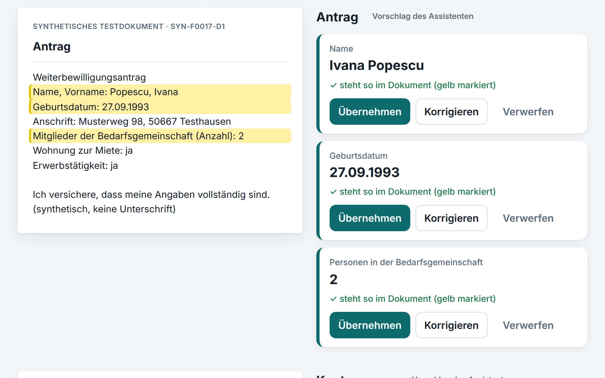

# Antragsassistent

**Weniger abtippen, Fehlendes sofort sehen: Der Antragsassistent liest die Nachweise eines Antrags im SGB II, schlägt jede
Angabe mit Fundstelle vor und zeigt, welcher Nachweis fehlt. Die Entscheidung trifft immer die Sachbearbeitung. Das
läuft heute, lokal, mit erfundenen Testdaten und der neuesten Generation offener KI-Modelle (Qwen3.8, Stand
11.11.2026).**


<sub>Rundgang, 85 Sekunden, ohne Ton, mit Untertiteln; aufgenommen am 11.11.2026 an einer laufenden Installation
mit dem Sprachmodell qwen3.8 auf einer GPU. Wartezeiten des Modells sind im Video gekürzt; die Anwendung zeigt die echte
Dauer an. [Video herunterladen (MP4, 1,6 MB)](https://github.com/panoherbe/antragsassistent/raw/main/medien/rundgang.mp4)
· Text des Rundgangs weiter unten.</sub>

## Was Sie brauchen → läuft hier schon

| Was Sie brauchen | läuft hier schon (gemessen am 11.11.2026: 40 erfundene Fälle, 133 Dokumente, 418 Angaben) |
|---|---|
| Dokumente eines Antrags automatisch auswerten | Dokumentart in 133 von 133 Dokumenten richtig; alle 418 Angaben richtig; 13,8 s je Dokument (Median; 95 % unter 19,1 s) mit dem offenen Modell qwen3.8 (27 Mrd. Parameter) auf einer Grafikkarte (GPU) mit 12 GB |
| Nachvollziehbare Vorschläge | jede Angabe mit Fundstelle, im Dokument gelb markiert; „belegt“ nur, wenn die zitierte Zeile wörtlich im Dokument steht (Groß-/Kleinschreibung und Leerzeichen zählen nicht) und den Wert enthält: alle 418 belegt und richtig; Unbelegtes lässt sich nicht übernehmen, nur selbst eintragen |
| Fehlende Nachweise erkennen | in 40 von 40 Fällen richtig (7 mit Lücke), nach einer lesbaren Regelliste (selbst ohne KI; sie prüft die vom Modell erkannten Dokumentarten), änderbar ohne Programmierung |
| Die Entscheidung bleibt beim Menschen | je Angabe übernehmen, korrigieren oder verwerfen, keine Sammelübernahme; „Fertig zur Prüfung“ erst, wenn nichts mehr offen ist; Export danach |
| Fragen zum SGB II beantworten | Suche in SGB II und SGB I §§ 60–67: erwarteter Paragraf bei 88,9 % von 45 Testfragen an erster Stelle, bei 95,6 % unter den ersten drei; in 15 von 15 Antworten stehen alle genannten Fundstellen unter den Treffern |
| Nachvollziehbar protokollieren | Protokoll nur erweiterbar, mit Hash-Kette (eine Änderung einzelner Einträge fällt bei der Prüfung auf); je Vorschlag das KI-Modell und die Version von Anweisung und Regeln |
| Rollen und Jobcenter trennen | Sachbearbeitung entscheidet, Prüfung liest, Administration prüft nur die Kette; Fälle anderer Jobcenter gesperrt |
| Daten bleiben im Haus | Modelle und Anwendung laufen auf demselben Rechner, kein Cloud-Dienst; Modelle austauschbar |
| Geprüfte Qualität | 24 automatische Tests grün (11.11.2026, [Testlauf](nachweis/tests-2026-11-11.txt)); alle Messläufe offen, auch die schlechteren |
| Offen und übergabefähig | Quellcode unter AGPL-3.0, beide Modelle unter Apache 2.0 |

**Neueste Modelle seit 11.11.2026:** qwen3.8 (27 Mrd. Parameter) statt qwen2.5 (7 Mrd.) und qwen3-embedding statt
bge-m3. Auf denselben 40 Fällen wie am 02.11.2026: Angaben richtig 95,9 % → 100 % (418 von 418), belegte Angaben richtig 99,3 % → 100 %, erwarteter Paragraf an erster Stelle 77,8 % → 88,9 %; Auslesen 4,2 s → 13,8 s je Dokument (Median), weil das Modell rund viermal so groß ist und auf der GPU mit 12 GB nur zur Hälfte Platz hat. Messweg, alle Messläufe und die verbleibenden Fehler:
[Messprotokoll](nachweis/PROTOKOLL.md).

## In zwei Minuten selbst prüfen

1. **Das Messprotokoll lesen:** [nachweis/PROTOKOLL.md](nachweis/PROTOKOLL.md) – Ergebnisse, die schlechteren Läufe
   und was noch falsch ist.
2. **Die Tests laufen lassen** (Docker, ohne Sprachmodell, gemessen 6 s ohne den ersten Bau des Images):
   ```bash
   git clone https://github.com/panoherbe/antragsassistent.git
   cd antragsassistent
   docker compose run --rm test
   ```
3. **Die ganze Anwendung starten** (Docker mit Compose, NVIDIA-GPU mit 12 GB und genug Arbeitsspeicher): Abschnitt
   „Start“ unten; die beiden Modelle sind zusammen 20 GB groß.

## Was Sie heute schon prüfen können

- **Wie die KI-Unterstützung arbeitet:** mit Fundstelle, menschlicher Entscheidung und Protokoll, in einer
  lauffähigen Anwendung mit einfacher Oberfläche.
- **Die gemessene Qualität:** an 133 Dokumenten, mit allen Messläufen und den verbleibenden Fehlern. Derselbe Messweg
  prüft in einem Auftrag jedes Modell und jede Änderung; so wurde am 11.11.2026 auf die neuesten Modelle gewechselt.
- **Von Anfang an eingebaut:** menschliche Letztentscheidung, Nachvollziehbarkeit, Rollen,
  Mandantentrennung und ein nur erweiterbares Protokoll mit Hash-Kette.
- **Keine Bindung an einen Anbieter:** offener Quellcode (AGPL-3.0), offene Modelle, Modelle austauschbar.

## So sieht es aus

<table>
<tr>
<td width="50%" valign="top"><br><sub>Nach dem Auslesen: wie lange es gedauert hat, welcher Nachweis fehlt (gefunden von der Regelliste anhand der erkannten Dokumentarten) und wie viele Angaben schon entschieden sind.</sub></td>
<td width="50%" valign="top"><br><sub>Jede Angabe mit Fundstelle: links das Dokument mit gelb markierten Zeilen, rechts die Vorschläge. Entschieden wird je Angabe.</sub></td>
</tr>
<tr>
<td width="50%" valign="top"><br><sub>Frage zum SGB II: Antwort nur aus den gefundenen Paragrafen, jede genannte Fundstelle gegen die Treffer geprüft. Ein Entwurf, keine Rechtsauskunft.</sub></td>
<td width="50%" valign="top"><br><sub>Das Protokoll, wie die Rolle „Prüfung“ es sieht: oben die Prüfung der Hash-Kette, darunter wer wann was entschieden hat (deutsche Zeit). Die Hash-Kette zeigt Änderungen an einzelnen Einträgen.</sub></td>
</tr>
</table>

<details>
<summary><b>Text des Rundgangs</b> (die Untertitel des Videos)</summary>

| ab | Untertitel |
|---|---|
| 0:00 | **Titel:** Nachweise lesen lassen. Selbst entscheiden. Der Assistent liest die Nachweise und schlägt jede Angabe mit Fundstelle vor. Die Entscheidung trifft die Sachbearbeitung. (Für das SGB II · KI-Modell Qwen3.8, lokal) |
| 0:08 | Ihre Fälle: neue Anträge mit ihren Nachweisen. |
| 0:11 | Ein Antrag mit drei Nachweisen. Ein Klick genügt. |
| 0:15 | Der Assistent liest die Nachweise – auf diesem Rechner, ohne Cloud-Dienst. (Wartezeit im Video gekürzt; die echte Dauer zeigt die Anwendung.) |
| 0:22 | Sofort sichtbar: Ein Nachweis fehlt. – Kleine Zeile: Feste Regelliste, angewandt auf die erkannten Dokumentarten · echte Lesedauer: 48 Sekunden (48,3 s) |
| 0:28 | Jede Angabe zeigt, wo sie im Dokument steht: gelb markiert, Wort für Wort geprüft. |
| 0:33 | Sie entscheiden jede Angabe: übernehmen, korrigieren oder verwerfen. |
| 0:37 | Alles entschieden: Der Fall geht zur Prüfung. (Die übrigen 8 Angaben ebenso entschieden, im Video übersprungen.) |
| 0:43 | Fertig zur Prüfung. Das Ergebnis gibt es als Datei zum Herunterladen. |
| 0:48 | Eine Frage zum SGB II? Der Assistent antwortet mit Paragraf. |
| 0:52 | Die Antwort nennt ihre Quelle; jede Fundstelle steht unter den gefundenen Paragrafen. (Ein Entwurf, keine Rechtsauskunft.) |
| 0:59 | Das Protokoll zeigt, wer wann was entschieden hat. Einträge lassen sich nur anhängen. |
| 1:04 | **Was die Sachbearbeitung davon hat** (gemessen am 11.11.2026 an 40 erfundenen Testfällen): Weniger abtippen – alle 418 Angaben richtig vorgeschlagen · Fehlendes sofort sehen – Vollständigkeit in 40 von 40 Testfällen richtig beurteilt (7 mit Lücke) · Jede Angabe mit Beleg – Fundstelle steht im Dokument; alle belegten Angaben richtig · Daten bleiben im Haus – das KI-Modell läuft auf dem eigenen Rechner |
| 1:17 | **Selbst ausprobieren:** github.com/panoherbe/antragsassistent. Quellcode, Tests und Messprotokoll liegen offen. (AGPL-3.0 · 24 Tests) |

</details>

## Was der Prototyp noch nicht ist

Ein Prototyp mit erfundenen Testdaten, kein Produkt. Er verarbeitet keine echten Personen- oder Sozialdaten und nimmt
nur Dokumente an, die als synthetisches Testdokument gekennzeichnet sind.

| Heute noch nicht enthalten | Was ein Auftrag ergänzen würde |
|---|---|
| Echte Nachweise: die synthetischen Dokumente sind Text aus Vorlagen; Scans, Tabellen in PDF und Handschrift sind schwerer, eine Texterkennung fehlt | Texterkennung und Messung an realistischen, freigegebenen Testdokumenten |
| Tempo auf passender Hardware: gemessen auf einer GPU mit 12 GB, auf der das Sprachmodell nur zur Hälfte Platz hat (der Rest rechnet im Arbeitsspeicher) | Betrieb auf einer GPU mit genug Speicher in einem EU-Rechenzentrum, dort neu gemessen |
| Eine fachlich abgestimmte Unterlagenliste; die mitgelieferte ist ein Beispiel | Ihre Regeln, mit Ihrer Fachseite festgelegt |
| Ein unabhängiger Maßstab für die Suche; der Goldsatz ist selbst geschrieben | Testfragen aus Ihrer Praxis |
| Anmeldung über OpenID Connect oder SAML, Anbindung an Fachverfahren oder DMS | Anbindung an Ihre Umgebung |
| Betrieb mit echten Daten, Einordnung nach der EU-KI-Verordnung | Betrieb in einem EU-Rechenzentrum, Einordnung und Dokumentation |
| Bescheide, Leistungsberechnung, Zahlungen | bewusst nicht Teil des Assistenten |

Antworten des Assistenten sind Entwürfe, keine Rechtsauskunft.

## Lizenz

Ab 04.11.2026 AGPL-3.0. Frühere Stände bis Commit [`4650be4`](https://github.com/panoherbe/antragsassistent/tree/4650be4) bleiben unter Apache-2.0. Auftraggeber erhalten im Auftrag die vertraglich vereinbarte Lizenz.

## Kontakt

Panagiotis Herbe · [panoherbe.com](https://panoherbe.com)

---

## Für Ihre IT: Technik im Detail

### Bausteine

| Baustein | Umsetzung |
|---|---|
| Eingang | Dokumente nur mit Kennung `SYN-…` (sonst abgewiesen und protokolliert), SHA-256 je Dokument |
| Dokumentart und Angaben | offenes Sprachmodell (lokal über Ollama) liest Dokumentart und Felder in ein festes JSON-Schema (strukturierte Ausgabe, Denkmodus aus) |
| Fundstellenprüfung | eine Angabe gilt nur als **belegt**, wenn die zitierte Zeile wörtlich im Dokument steht und den Wert enthält; unbelegte Angaben können nicht übernommen, nur von Hand eingetragen werden |
| Unterlagenliste und Plausibilität | feste Regeln ohne KI in `konfiguration/unterlagen.yaml` (Beispielkonfiguration), lesbar und änderbar ohne Programmierung; Ausdrücke werden nicht frei ausgewertet |
| Menschliche Letztentscheidung | Entscheidung je Angabe, keine Sammelübernahme; Status „Fertig zur Prüfung“ erst, wenn nichts mehr offen ist; Export nur danach |
| Fragen zum SGB II | Suche in SGB II und SGB I §§ 60–67 mit Einbettungen (qwen3-embedding:4b, mit Aufgabenbeschreibung vor der Frage; BM25 und die Kombination sind gemessen und schwächer), Antwort nur aus den gefundenen Normen, jede genannte Fundstelle wird gegen die Treffer geprüft |
| Oberfläche | eine Hauptaktion je Bildschirm, Alltagsdeutsch, Beträge in Euro, Fundstellen gelb markiert; ohne JavaScript bedienbar (ein kleines Skript zeigt nur den Wartezustand) |
| Rollen | Sachbearbeitung (entscheidet), Prüfung (liest Fälle und Protokoll, entscheidet nicht), Administration (prüft nur die Protokollkette, sieht keine Fallinhalte) |
| Mandanten | jede fachliche Tabelle trägt die Jobcenter-Kennung; fremde Fälle sind gesperrt |
| Protokoll | nur erweiterbar (Datenbank-Trigger), Hash-Kette über alle Einträge; eine Änderung einzelner Einträge fällt bei der Prüfung auf; Modell, Prompt-Version, Regelversion und Dauer je Vorschlag |
| Schnittstelle | REST mit OpenAPI (`/docs`, `/openapi.json`), Export als JSON |

**Bewusst nicht umgesetzt:** Berechnung des Leistungsanspruchs, Bescheide, Zahlungen, Anbindung an Fachverfahren
oder DMS, Texterkennung gescannter Papierdokumente (die synthetischen Dokumente sind Text), Anmeldung über
OpenID Connect/SAML, Betrieb mit echten Daten.

### Wo was läuft

| Teil | Ort |
|---|---|
| Sprachmodell `qwen3.8:27b` (Apache 2.0, 17,7 GB) und Einbettungsmodell `qwen3-embedding:4b` (Apache 2.0, 2,5 GB) | eigener Ollama-Container auf demselben Rechner; kein Aufruf eines Cloud-Dienstes. Auf einer GPU mit 12 GB liegt gut die Hälfte (55 %) des Sprachmodells auf der GPU, der Rest im Arbeitsspeicher; die Einbettungen rechnet der Prozessor (`EINBETTUNG_CPU=1`), damit das Sprachmodell geladen bleibt |
| Anwendung (FastAPI, SQLite) | Container, lauscht nur auf `127.0.0.1` |
| Gesetzestexte | einmalig von gesetze-im-internet.de geladen (`normen/laden.py`), Prüfsumme in `normen/quelle.json`; amtliche Werke nach § 5 UrhG (`normen/HINWEIS.md`) |

Die Modelle sind über `OLLAMA_URL`, `SPRACHMODELL` und `EINBETTUNGSMODELL` austauschbar, etwa gegen einen Modelldienst
mit Verarbeitung in der EU. Kein anderer Teil des Codes spricht mit einem Modell (`app/llm.py`).

### Start

Voraussetzung: Docker mit Compose, eine NVIDIA-GPU mit 12 GB und Arbeitsspeicher für den Rest des Sprachmodells
(gemessen auf einer RTX 3060 mit 12 GB und 62 GB Arbeitsspeicher; 32 GB sollten reichen, nicht gemessen). Auf einer
GPU ab 24 GB sollten beide Modelle Platz haben (nicht gemessen): dann `EINBETTUNG_CPU=0` setzen.

```bash
echo "DEMO_PASSWORT=$(openssl rand -hex 8)" > .env      # Passwort der Demo-Kennungen
docker compose up -d
docker compose exec ollama ollama pull qwen3.8:27b
docker compose exec ollama ollama pull qwen3-embedding:4b
# Oberfläche: http://127.0.0.1:8420  (Kennungen sb.a, sb.b, pruef.a, admin; Passwort aus .env)
```

Beim Start legt die Anwendung 20 synthetische Fälle für zwei fiktive Jobcenter an (`DEMO_FAELLE`).

```bash
docker compose run --rm test                                          # 24 Tests, ohne Modell
docker compose run --rm app python -m normen.laden                    # Gesetzestexte neu laden
docker compose run --rm app python -m eval.messen --faelle 40 --startwert 9001 --assistent 15 --ausgabe nachweis/neu   # Messlauf wie v4
```

### Aufbau

```
app/synth.py        Generator synthetischer Fälle (Antrag, Entgeltabrechnung, Mietbescheinigung, Kontoauszug)
app/extraktion.py   Dokumentart, Felder, Fundstellenprüfung
app/regeln.py       Unterlagenliste und Plausibilitätsregeln aus YAML
app/suche.py        BM25, Einbettungen, Kombination (Reciprocal Rank Fusion), alle drei gemessen
app/assistent.py    Antworten mit geprüften Fundstellen
app/dienst.py       Fachlogik mit Rollen- und Mandantenprüfung
app/audit.py        Protokoll mit Hash-Kette
app/anzeige.py      Feldnamen, Beträge, Status und Protokolleinträge in Alltagsdeutsch
app/main.py         Oberfläche und REST
eval/               Goldsatz (selbst geschrieben) und Messlauf
nachweis/           Messprotokolle
medien/             Rundgang (Video, GIF) und Bilder für diese Seite
```

### Einordnung

Eine Einordnung nach der EU-KI-Verordnung (Anhang III Nr. 5 Buchst. a, Art. 6 Abs. 3) ist für einen echten Einsatz
nötig; der Prototyp ist so gebaut, dass Protokollierung, menschliche Aufsicht und Nachvollziehbarkeit von Anfang an
vorhanden sind.

### Rundgang und Bilder

Aufgenommen am 11.11.2026 mit Playwright (Chromium) an einer laufenden Installation dieses Repositorys auf einem
Linux-Server mit NVIDIA RTX 3060 (12 GB): Ollama 0.40.16, `qwen3.8:27b` (Digest aaee06c39dcf) und `qwen3-embedding:4b`
(Digest df5bd2e3c74c), dieselben Modelle wie im Messprotokoll, 20 synthetische Demo-Fälle. Vor der Aufnahme liefen die
Modelle einmal warm, mit einem Fall und einer Frage des zweiten fiktiven Jobcenters (im gezeigten Protokoll nicht
sichtbar). Wartezeiten des Modells sind im Video gekürzt, die echte Dauer steht in der Anwendung. Im Video ist
eine Entscheidung zu sehen; die übrigen Angaben des Falls sind ebenso entschieden, im Video übersprungen. Untertitel,
Hervorhebung und Mauszeiger sind in die Seite gezeichnet, ohne Ton. Die Zahlen der Schlusskarten stammen aus dem
Messprotokoll vom 11.11.2026, nicht aus der Aufnahme. Die Antwort auf die Frage im Video („Wann gilt jemand als erwerbsfähig?“) gibt § 8 Abs. 1 SGB II fast wörtlich wieder und nennt § 7 als Grundlage; geprüft am Gesetzestext (Fassung in `normen/` vom 02.11.2026 und gesetze-im-internet.de am 11.11.2026); im Messlauf und in der Aufnahme kam sie wortgleich. Die frühere Beispielfrage zum Bewilligungszeitraum ist nicht mehr im Video: qwen3.8 nannte dazu zusätzlich eine abgelaufene Sonderregel aus der Corona-Zeit (§ 67 Abs. 4 SGB II) als geltendes Recht.
Neu aufgenommen am 11.11.2026 mit den neuesten Modellen und der vereinfachten Oberfläche; die Aufnahmen vom 03., 04. und
10.11.2026 (qwen2.5, bge-m3) sind ersetzt.

Lizenz: AGPL-3.0 (bis Commit `4650be4` Apache-2.0).
